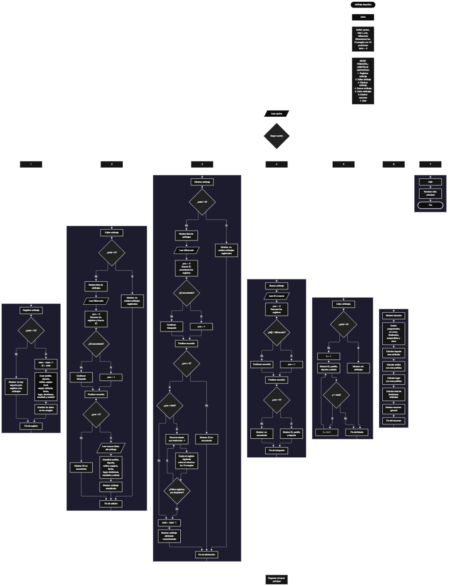

Este proyecto, llamado <b>arbitraje deportivo</b>, fue desarrollado en <b>java</b> como un ejercicio práctico para fortalecer la lógica de programación mediante la creación de un sistema de gestión de arbitrajes deportivos desde la consola. El programa cuenta con un menú principal de siete opciones que permite <b>registrar, editar, eliminar, buscar, listar y analizar información de los arbitrajes registrados</b>. Cada arbitraje almacena datos como el nombre del partido, deporte, árbitro responsable, equipos participantes, fecha, lugar, cantidad de decisiones arbitrales, resultado y estado del arbitraje, utilizando arreglos con una capacidad máxima de <b>10 arbitrajes durante la ejecución</b>. Durante su desarrollo se aplicaron conceptos fundamentales de programación, como variables, arreglos, estructuras condicionales, ciclos repetitivos y estructuras de selección, además de procesos para buscar, modificar, eliminar y organizar registros. El programa también incorpora estadísticas relacionadas con la actividad arbitral registrada. Este proyecto permite poner en práctica los conocimientos adquiridos en Java y sirve como base para desarrollar sistemas de gestión más avanzados utilizando otros lenguajes y tecnologías.

<h2 align="center">⚙️ Funcionamiento del menú principal</h2>

### ➕ Registrar arbitraje

La opción <b>1) registrar arbitraje</b> permite almacenar un nuevo arbitraje deportivo dentro del sistema. Antes de realizar el registro, el sistema comprueba que la cantidad de arbitrajes almacenados sea menor a <b>10</b>, utilizando la condición <b>total &lt; partidos.length</b>. Si existe espacio disponible, la variable <b>total</b> aumenta en uno y el programa solicita el <b>nombre del partido, deporte, árbitro, equipo local, equipo visitante, fecha, lugar, cantidad de decisiones arbitrales, resultado y estado</b>. Los datos se almacenan en la posición correspondiente de sus respectivos arreglos. Finalmente, muestra el mensaje <b>"Arbitraje registrado correctamente."</b>. Si el sistema alcanza su capacidad máxima, presenta el mensaje <b>"No hay espacio para registrar mas arbitrajes."</b>, impidiendo registrar nuevos arbitrajes.

### ✏️ Editar arbitraje

La opción <b>2) editar arbitraje</b> permite modificar la información de un arbitraje registrado. Primero, el programa comprueba si existen arbitrajes almacenados mediante la variable <b>total</b>. Si no hay registros, muestra el mensaje <b>"No existen arbitrajes registrados."</b>. En caso contrario, presenta una lista con el identificador, partido, deporte, árbitro, equipos participantes, fecha, lugar, decisiones arbitrales, resultado y estado de cada arbitraje. Después, solicita el identificador del arbitraje que se desea editar y comprueba que esté dentro del rango permitido mediante la condición <b>idEditar &gt;= 1 y idEditar &lt;= total</b>. Si la selección es válida, solicita nuevamente toda la información del arbitraje y actualiza directamente los valores de los arreglos correspondientes. Finalmente, presenta el mensaje <b>"Arbitraje actualizado correctamente."</b>. Si el identificador seleccionado no corresponde a un arbitraje registrado, informa que el arbitraje seleccionado no existe.

### 🗑️ Eliminar arbitraje

La opción <b>5) eliminar arbitraje</b> permite eliminar un arbitraje registrado mediante su identificador dentro de la colección. Antes de comenzar, el programa comprueba que existan arbitrajes almacenados. Si la colección está vacía, muestra el mensaje <b>"No existen arbitrajes registrados."</b>. Si hay registros disponibles, presenta una lista con la información de cada arbitraje. Después, solicita el identificador del arbitraje que se desea eliminar y verifica que la selección esté dentro del rango válido. Si el arbitraje existe, comienza el proceso de eliminación. Para mantener los registros organizados, utiliza un ciclo <b>for</b> controlado por la variable <b>i</b>, que desplaza una posición hacia atrás los datos de los arbitrajes posteriores en los arreglos <b>partidos, deportes, arbitros, equiposLocales, equiposVisitantes, fechas, lugares, decisiones, resultados y estados</b>. Posteriormente, disminuye la variable <b>total</b> en uno y muestra el mensaje <b>"Arbitraje eliminado correctamente."</b>. Si el identificador seleccionado no corresponde a un arbitraje registrado, informa que el arbitraje seleccionado no existe.

### 🔎 Buscar arbitraje

La opción <b>4) buscar arbitraje</b> permite localizar un arbitraje mediante su identificador. Primero, el programa comprueba si existen arbitrajes registrados. Si el sistema está vacío, muestra el mensaje <b>"No existen arbitrajes registrados."</b>. En caso contrario, solicita el identificador del arbitraje que se desea buscar. A continuación, verifica que el valor introducido se encuentre dentro del rango válido mediante la condición <b>idBusqueda &gt;= 1 y idBusqueda &lt;= total</b>. Cuando encuentra una coincidencia, muestra el partido, deporte, árbitro, equipos participantes, fecha, lugar, decisiones arbitrales, resultado y estado correspondiente al registro consultado. Si el identificador introducido no corresponde a ningún arbitraje registrado, presenta el mensaje <b>"ID no encontrada."</b>.

### 📋 Listar arbitrajes

La opción <b>3) listar arbitrajes</b> permite visualizar todos los arbitrajes registrados actualmente en el sistema. Antes de mostrar la información, el programa comprueba si la variable <b>total</b> es igual a cero. Si no existen registros, presenta el mensaje <b>"No existen arbitrajes registrados."</b>. Si hay arbitrajes disponibles, utiliza un ciclo <b>for</b> para recorrer los arreglos desde la primera posición hasta el número total de arbitrajes registrados. Durante el recorrido, muestra el identificador, partido, deporte, árbitro, equipo local, equipo visitante, fecha, lugar, decisiones arbitrales, resultado y estado de cada arbitraje almacenado. Esta función facilita consultar los registros existentes sin necesidad de buscar cada arbitraje individualmente.

### 📄 Mostrar resumen

La opción <b>6) mostrar resumen</b> permite consultar información estadística relacionada con los arbitrajes deportivos registrados. Primero, el programa comprueba si existen arbitrajes almacenados. Si no existen registros, muestra el mensaje <b>"No existen arbitrajes registrados."</b>. En caso contrario, calcula la cantidad de arbitrajes programados, en curso, finalizados, suspendidos y pertenecientes a otros estados. También determina el deporte más arbitrado, el árbitro que ha participado en más partidos, el lugar con mayor cantidad de encuentros registrados y el total de decisiones arbitrales realizadas. Finalmente, presenta toda esta información en forma de resumen general.

### 🚪 Salir del menú principal

La opción <b>7) salir</b> está destinada a finalizar la ejecución del programa y muestra el mensaje <b>"Gracias por utilizar Arbitraje Deportivo."</b>. El menú principal se encuentra dentro de una estructura repetitiva <b>do ... while</b>, que mantiene el programa en funcionamiento mientras se realizan las operaciones disponibles. La condición final es <b>opcion != 7</b>, por lo que al seleccionar la opción 7 el programa finaliza correctamente.

<h2 align="center">🧠 Temas aplicados en el proyecto</h2>

### 📦 Variables

En este proyecto se utilizan variables para guardar la opción seleccionada en el menú, controlar la cantidad de arbitrajes registrados, recorrer los arreglos, seleccionar los arbitrajes que se desean editar, eliminar o consultar y almacenar los resultados estadísticos generados durante el resumen. Cada variable cumple una función específica dentro de las operaciones de gestión de arbitrajes deportivos.

🔢 **Opcion:** Almacena la opción seleccionada por el usuario en el menú principal.

📊 **Total:** Almacena la cantidad actual de arbitrajes registrados.

🔄 **I:** Funciona como contador en los ciclos <b>for</b>.

🆔 **IdEditar:** Almacena el identificador del arbitraje que se desea modificar.

🔎 **IdBusqueda:** Almacena el identificador utilizado para realizar una búsqueda.

🗑️ **IdEliminar:** Almacena el identificador del arbitraje que se desea eliminar.

📈 **TotalDecisiones:** Almacena el total de decisiones arbitrales registradas.

### 🗃️ Arreglos

En este proyecto se utilizan diez arreglos relacionados con los datos de cada arbitraje. Cada arreglo tiene una capacidad de <b>10 posiciones</b> y utiliza el mismo índice para representar la información correspondiente a un mismo arbitraje.

⚽ **Partidos:** Almacena los nombres de los partidos registrados.

🏅 **Deportes:** Almacena los deportes asociados a cada partido.

👨‍⚖️ **Arbitros:** Almacena los nombres de los árbitros.

🏠 **EquiposLocales:** Almacena los equipos locales.

✈️ **EquiposVisitantes:** Almacena los equipos visitantes.

📅 **Fechas:** Almacena las fechas de los partidos.

📍 **Lugares:** Almacena los lugares donde se realizan los encuentros.

📋 **Decisiones:** Almacena la cantidad de decisiones arbitrales.

🏆 **Resultados:** Almacena los resultados de los partidos.

📌 **Estados:** Almacena el estado actual de cada arbitraje.

### 🔀 Estructuras condicionales

En este proyecto se utilizan las estructuras <b>if</b> y <b>else</b> para comprobar si el sistema dispone de espacio antes de registrar un arbitraje, verificar si existen registros antes de realizar determinadas operaciones, validar el identificador seleccionado para editar, eliminar o consultar un arbitraje y clasificar los estados utilizados durante el resumen estadístico.

### 🔄 Estructuras repetitivas

En este proyecto se utilizan los ciclos <b>for</b> y <b>do ... while</b>. Los ciclos <b>for</b> permiten recorrer los arreglos para mostrar arbitrajes, generar estadísticas, buscar registros y reorganizar la información durante las eliminaciones. Por otro lado, el ciclo <b>do ... while</b> mantiene activo el menú principal durante toda la ejecución del programa.

### 🎯 Estructura según

El programa evalúa el valor almacenado en la variable <b>opcion</b> y ejecuta el bloque de instrucciones correspondiente. Cada caso representa una operación específica del sistema: <b>registrar, editar, eliminar, buscar, listar, mostrar resumen o salir</b>. También se utiliza el bloque <b>default</b> para mostrar el mensaje <b>"Opcion no valida."</b>.

### 🔢 Dimensionamiento de arreglos

El programa utiliza arreglos con una capacidad de <b>10 posiciones</b> para almacenar la información relacionada con los arbitrajes deportivos. La cantidad de posiciones ocupadas se controla mediante la variable <b>total</b>, por lo que las operaciones recorren únicamente los registros comprendidos entre la primera posición y el total actual de arbitrajes registrados.

### 🔄 Reorganización de registros

Cuando se selecciona un arbitraje para eliminarlo, el programa utiliza un ciclo <b>for</b> que comienza en la posición seleccionada y llega hasta <b>total - 1</b>. En cada repetición, los datos de la posición siguiente se copian sobre la posición actual en los arreglos <b>partidos, deportes, arbitros, equiposLocales, equiposVisitantes, fechas, lugares, decisiones, resultados y estados</b>. Después, la variable <b>total</b> disminuye en uno. De esta manera, los arbitrajes posteriores ocupan las posiciones disponibles sin dejar espacios vacíos entre los registros activos.

<h2 align="center">¿Cómo se implementaron las operaciones CRUD en el proyecto?</h2>

Las operaciones <b>CRUD</b> se implementaron mediante las opciones del menú principal, permitiendo administrar los arbitrajes registrados. La operación <b>crear</b> corresponde a <b>registrar arbitraje</b>; <b>leer</b> se realiza mediante las opciones <b>buscar arbitraje, listar arbitrajes y mostrar resumen</b>; <b>actualizar</b> corresponde a <b>editar arbitraje</b>; y <b>eliminar</b> se realiza mediante la opción <b>eliminar arbitraje</b>. Estas operaciones utilizan variables, arreglos, condicionales y ciclos para gestionar la información almacenada durante la ejecución.

<h2 align="center">Diagrama de flujo del proyecto</h2>

<h2 align="center">🛡️ Validaciones del programa</h2>

### 📭 No existen arbitrajes registrados

Esta validación se utiliza en las opciones de <b>editar, eliminar, buscar, listar y mostrar resumen</b>. El programa comprueba si la variable <b>total</b> es igual a <b>0</b> y, si no existen arbitrajes registrados, muestra el mensaje <b>"No existen arbitrajes registrados."</b>.

### ⚠️ Capacidad máxima alcanzada

Esta validación se utiliza durante el registro de nuevos arbitrajes para controlar la capacidad máxima de los arreglos. El programa comprueba si <b>total &lt; partidos.length</b>. En caso contrario, muestra el mensaje <b>"No hay espacio para registrar mas arbitrajes."</b>.

### ❌ Arbitraje no encontrado

Esta validación se utiliza durante las operaciones de búsqueda, edición y eliminación. El programa verifica que el identificador introducido sea mayor o igual a <b>1</b> y menor o igual al valor de <b>total</b>. Si la selección es inválida, muestra el mensaje <b>"ID no encontrada."</b>.

### 🔢 Selección de arbitrajes

El programa utiliza identificadores para seleccionar los arbitrajes que se desean editar, eliminar o consultar. Esta validación evita acceder a posiciones que no contienen información válida.

### ⚠️ Opción inválida

La estructura <b>switch</b> incluye el bloque <b>default</b>, que muestra el mensaje <b>"Opcion no valida."</b> cuando el usuario introduce una opción inexistente.

<h2 align="center">🎯 Objetivo del proyecto</h2>

El objetivo principal de este proyecto es fortalecer la <b>lógica de programación</b> mediante el desarrollo de un sistema de gestión de arbitrajes deportivos en <b>java</b>. A través de su construcción se busca aplicar los conocimientos adquiridos sobre variables, arreglos, estructuras condicionales, ciclos repetitivos y estructuras de selección, integrándolos para resolver un problema de manera organizada. Además, el proyecto permite comprender cómo registrar, consultar, modificar, eliminar y analizar información en una aplicación de consola, estableciendo una base para desarrollar sistemas de gestión más completos con otros lenguajes y tecnologías.

